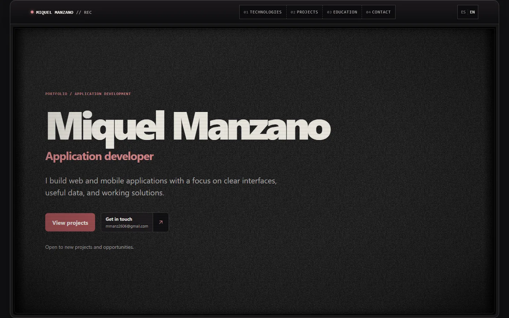
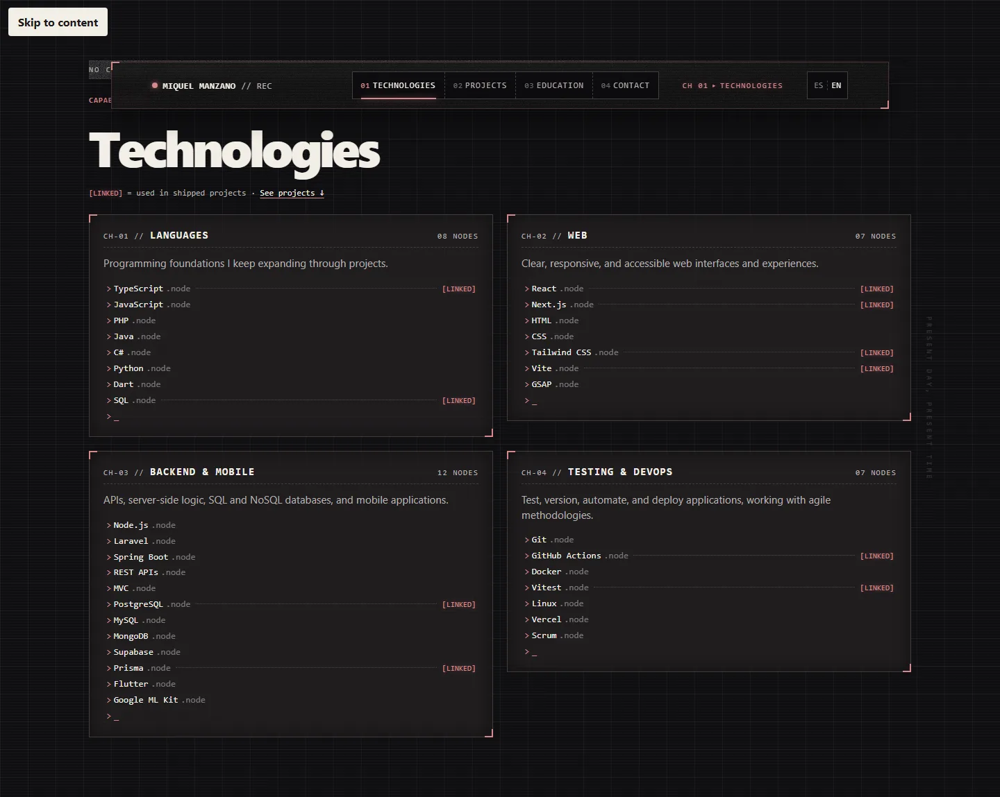

# Miquel Manzano — Portfolio

> Bilingual developer portfolio with a broadcast-terminal aesthetic, built as a fully static Next.js site.

[](https://github.com/Goti112/portfolio/actions/workflows/ci.yml)
[](https://www.miquelmanzano.com)

**Live:** [www.miquelmanzano.com](https://www.miquelmanzano.com)



## About

This is my personal portfolio as an application developer. It is designed for
recruiters first: every section answers a concrete question in a few seconds
(what I build, which technologies I use, which projects prove it, where I
studied, and how to reach me), wrapped in a "Wired" broadcast-terminal visual
identity.

## Highlights

- **Bilingual content (ES / EN)** from a single typed content model, with
  validation that keeps both languages structurally in sync.
- **Channel-style navigation** with a scroll-spy header that marks the
  current section.
- **Technologies linked to real projects**: a capability is flagged `[LINKED]`
  only when a published project actually uses it, so the list stays honest.
- **Project cards built for scanning**: what it does, what I built, stack,
  real screenshots and a click-to-enlarge viewer.
- **Accessible and motion-aware**: keyboard navigation, skip link, automated
  axe checks, and every animation respects `prefers-reduced-motion`.
- **Fully static export** served by Vercel, with no client-side data fetching.



## Tech stack

| Area | Tools |
| --- | --- |
| Framework | Next.js 16 (static export), React 19 |
| Language | TypeScript |
| Styling | Modern CSS with design tokens, no UI framework |
| Motion | GSAP + ScrollTrigger |
| Quality | ESLint, strict TypeScript, content validation scripts |
| Testing | Playwright end-to-end tests, axe-core accessibility checks |
| Delivery | GitHub Actions CI, Vercel |

## Getting started

Requirements: Node.js 24 and npm.

```bash
npm install
npm run dev
```

Open [http://localhost:3000](http://localhost:3000). Spanish is served at `/`
and `/es`, English at `/en`.

## Scripts

| Command | Description |
| --- | --- |
| `npm run dev` | Start the development server |
| `npm run build` | Build the static site into `out/` |
| `npm start` | Serve the built site locally |
| `npm run lint` | Run ESLint |
| `npm run typecheck` | Generate route types and run the TypeScript compiler |
| `npm run validate:content` | Validate the ES and EN content files |
| `npm run test:e2e` | Build and run the Playwright test suite |

## Project structure

```text
src/
  app/          Routes and layouts for each locale
  components/   Page sections (header, technologies, projects, education, contact)
  content/      Typed ES / EN content and external destinations
  lib/          Content validation and shared helpers
  motion/       GSAP scenes and motion contracts
  styles/       Design tokens and section styles
tests/          Playwright end-to-end and accessibility tests
scripts/        Content validation and local static server
```

## Related projects

- [BorderPass AI](https://github.com/Goti112/borderpass-ai) — auditable CBAM compliance workspace for import operations.
- [QGC Planner](https://github.com/Goti112/Mission-Planner-Demo) — web mission planner for drones with 2D and 3D views.

## Contact

- Website: [miquelmanzano.com](https://www.miquelmanzano.com)
- Email: [mmanz2606@gmail.com](mailto:mmanz2606@gmail.com)
- GitHub: [@Goti112](https://github.com/Goti112)

---

© Miquel Manzano. All rights reserved. The source code is public for reference;
please do not reuse the design or content without permission.
